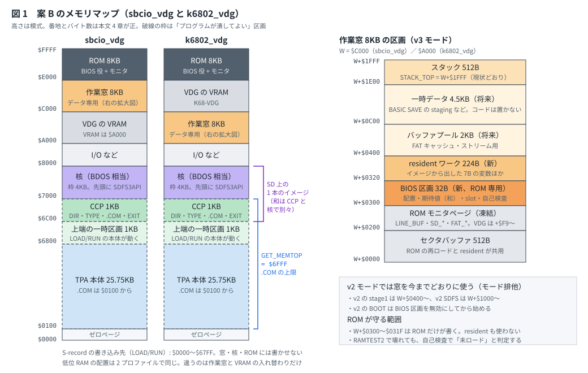
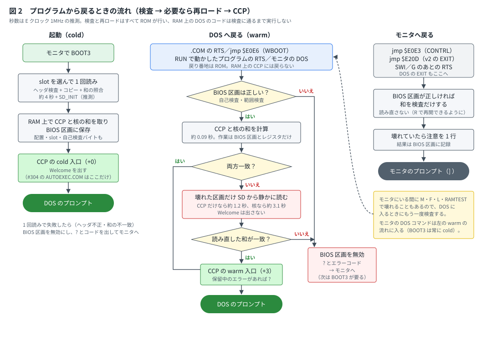

# Issue #310 SDFS/68 v3 案 B の配置と ROM/resident ABI

親epic: #296 SDFS/68 v3 phase 2 実機起動・system運用epic

## 位置づけ

案 B（CP/M 式の完全分離）は 2026-11-25 に決定した。この文書は、案 B の改造設計（BIOS 入口表、BIOS 区画、CCP 入口表、メモリマップ、API major 2、戻り口）を Git 管理下に固定する。以後の Issue（#311〜#318 と、書き換える既存 Issue）は、この文書を正として実装する。

- 経緯と前提の決定: TsumiWiki「SDFS68 v3 コマンド解釈部の置き場所 再検討」9〜11 章
- 設計の決定版: TsumiWiki「SDFS68 v3 案B 改造設計」。この文書はその 0〜10 章を移したもの
- 数字の出どころは、計測メモと `main` の bcb4670 のソース。推測した値には「（推測）」と付けた。秒数はすべて E クロック 1MHz の推測
- 設計メモの Issue 仮番号 I-0〜I-8 は、次の実番号に置き換えた

| 仮番号 | Issue | 内容 |
| --- | --- | --- |
| I-0 | #310 | この文書（docs） |
| I-1 | #311 | resident の書き換わる変数をイメージの外へ出し、核から CCP への参照をなくす |
| I-2 | #312 | ROM に BIOS 入口表・RAM の和のルーチン・BIOS 区画を追加する |
| I-3 | #313 | v3 を案 B の配置へ切り替え、CCP を DOS のプロンプトとして独立させる |
| I-4 | #314 | 戻り口の検査と静かな再ロードを ROM に入れ、BOOT3 を 1 回読みにする |
| I-5 | #315 | v3 のファイル API（slot 2〜5）を実装し、`.COM` の起動を核へ移す |
| I-6 | #316 | LOAD.COM・RUN.COM・XLDR.OVL を作り、CCP から LOAD と RUN を外す |
| I-7 | #317 | v3 resident の SD ドライバを ROM の BIOS 入口へ寄せる |
| I-8 | #318 | 案 B の ROM を焼き、実機で起動・戻り・回復を確かめる |

用語: 「核」は BDOS 相当（FAT32・パス解決・ファイル API）、「CCP」は DOS のプロンプトとコマンド解釈部、「窓」は作業窓 8KB（バンク RAM、W はその先頭）、「WBOOT」は DOS へ warm で入る ROM の入口。

## 図





- 図 1: [images/plan-b-memmap.svg](images/plan-b-memmap.svg)
- 図 2: [images/plan-b-return-flow.svg](images/plan-b-return-flow.svg)

## 0. 要約

- **ROM が持つのは 3 つだけ**: 固定番地の BIOS 入口表（`$E0E6` から 16 本）、窓の中の BIOS 区画（32B、ROM だけが書く）、SDFS3SYS ヘッダの読み方。resident の番地、API のスロット番号、`GET_MEMTOP` は ROM に埋めない。ROM は resident のスロットを 1 本も呼ばない
- **低位 RAM の配置は 2 プロファイル（sbcio_vdg・k6802_vdg）で共通**: `$0100-$67FF` TPA 本体、`$6800-$6BFF` 上端の一時区画、`$6C00-$6FFF` CCP、`$7000-$7FFF` 核。`GET_MEMTOP` は `$6FFF`
- **検査と再ロードを分ける**: 戻り口はすべて ROM を通る。モニタ行きの戻りでは検査と記録だけ行い、DOS へ入るときにもう一度検査して、壊れた区画（CCP／核）だけ SD から読み直す。期待値は SD のヘッダに新しい欄を足さず、cold 起動で検証済みのイメージを RAM に置いた直後に計算して BIOS 区画に保存する
- **CCP と核は 1 本のイメージ**。和は区画ごとに 2 本持つので、CCP だけの読み直し（約 1.2 秒、推測）ができる
- 実装は 9 件の新しい Issue（#310〜#318）と、既存 6 件（#299、#301〜#304、#307）の書き換えに分ける。ROM はエミュレータで確かめながら進め、実機に焼くのは最後の 1 回（#318）にまとめる

## 1. ROM 側

### 1-1. 戻り口を ROM に集める

| 戻り方 | 今の行き先 | 案 B の行き先 | 検査 |
| --- | --- | --- | --- |
| `.COM` の `RTS` | resident の中（`jsr $0100` の直後） | **ROM の WBOOT**（BIOS の EXEC が戻り番地として積む） | 検査し、必要なら再ロードして CCP へ |
| プログラムの `jmp $E0E6`（新設の WBOOT） | ― | ROM の WBOOT | 同上 |
| `RUN` で起動したプログラムの `RTS` | 不定（`lds #STACK_TOP` のあと `jmp`） | ROM の WBOOT（RUN.COM も EXEC で起動する） | 同上 |
| モニタの `DOS` コマンド（新設） | ― | ROM の WBOOT と同じ門 | 同上 |
| `jmp $E0E3`（`MIKBUG_CONTRL`） | `MONITOR_ENTRY` | `MONITOR_ENTRY` → `$E20D` のフック → モニタ | 検査と記録のみ |
| `jmp $E20D`（`MONITOR_REENTRY`、v2 の `EXIT`） | `jmp MAIN_LOOP` の命令 | 同じ番地の命令を `jmp MON_GATE` に変える | 検査と記録のみ |
| SWI | `SWI_HANDLER` → BRK 表示 | レジスタ退避の直後にフック | 検査と記録のみ |
| `G` で起動したプログラムの `RTS` | 不定（`jmp 0,x`） | `G` が `MON_GATE` を戻り番地として積む（決定 4） | 検査と記録のみ |
| DOS の `EXIT` | ― | BIOS の MONITOR 入口 → `MON_GATE` | 検査と記録のみ |
| RESET | モニタ | モニタ（BIOS 区画は消さない） | しない |

- `CONTRL` は `MONITOR_ENTRY` を通って `$E20D` の命令に着く。このため `$E20D` を 1 か所フックすれば、`CONTRL` と `MONITOR_REENTRY` の両方に掛かる。`$E20D` は v2 の `sdfs68.asm` が決め打ちで飛び込む番地なので、ラベル `MONITOR_REENTRY_AT` を置き、`MONITOR_BASE+$0D` とずれたらアセンブルエラーにする
- このアサート、BIOS 入口表、BIOS 区画、各フックは `MONITOR_FEATURE_SD` が 1 のときだけ組み込む。base（KEYBOARD=0）では `jmp MAIN_LOOP` が `+$06` に来るので、無条件のアサートは `make test` の base ビルドを落とす。base は `MIKBUG_VAR_BASE=$1F00`・スタック `$1F42` で、窓の区画もない
- SWI のあと `R` で再開したプログラムの `RTS` を WBOOT に戻すには、プログラムとモニタのスタックを分ける（決定 16）
- **モニタ行きでは読み直さない**。SWI のあと `R` で再開するプログラムが CCP 領域をデータに使っていると、読み直しで壊れる。壊れた中身を `D` で調べる機会も失う。壊れていたら注意を 1 行（例: `*SDFS3 CCP` / `*SDFS3 CORE`）出し、結果を BIOS 区画の `STATE` に記録する
- **DOS へ入るときにもう一度検査する**。モニタにいる間に `M`・`F`・`L`・`RAMTEST1`（上限 `$7FFF`）で壊れることがある。戻り口での検査だけでは、これを見逃す
- 検査は BIOS 区画とレジスタだけを使う。`FAT_*`、`SD_SECTOR_BUF`、`LINE_BUF` には触れない。v2 モード（BIOS 区画が無効）では、自己検査で即座に抜けて何もしない
- RAM 上の DOS のコードを実行するのは、DOS の門（WBOOT）で検査に通ったあとだけ。プログラムの実行中に BDOS が呼ばれた場合は検査しない（CP/M と同じ。防げないこととして残す）

### 1-2. RAM 用の和のルーチン

- 16bit の加算和。入力は X = 開始番地、BIOS 区画の作業欄 = 最終番地。出力は A:B = 和
- ループは `addb 0,x` / `adca #0` / `inx` / `cpx 拡張` / `bne` の 5 命令で、1 バイト約 20 サイクル（推測）。CCP 1KB と核 約 3.3KB（推測）を足して約 4.3KB、約 0.09 秒（推測）
- BOOT3 の `BOOT3_SUM_CURRENT`（`SD_SECTOR_BUF` 固定、約 104 サイクル／バイト）は流用しない。RAM を読めず遅い
- 置き場は MIKBUG の隙間（BIOS 入口表の後ろ）か、ROM 末尾の空き。約 30〜40B（推測）

### 1-3. 期待値の置き場（BIOS 区画）

窓のページ `W+$0300-$031F`（W は作業窓の先頭。sbcio_vdg は `$C000`、k6802_vdg は `$A000`）を、ROM だけが書く BIOS 区画にする。

| オフセット | サイズ | 名前 | 中身 |
| --- | ---: | --- | --- |
| `+$00` | 2 | `BB_MAGIC` | `$B3,$4C`。区画が使われている印 |
| `+$02` | 2 | `BB_IMG_BASE` | イメージの先頭（= CCP の先頭） |
| `+$04` | 2 | `BB_CORE_BASE` | 核の先頭（= SDFS3API ヘッダの番地） |
| `+$06` | 2 | `BB_IMG_LAST` | イメージの最終番地 |
| `+$08` | 2 | `BB_SUM_CCP` | `[IMG_BASE, CORE_BASE)` の和 |
| `+$0A` | 2 | `BB_SUM_CORE` | `[CORE_BASE, IMG_LAST]` の和 |
| `+$0C` | 2 | `BB_CCP_VEC` | CCP 入口表の番地（+0 cold／+3 warm） |
| `+$0E` | 2 | `BB_SLOT_LBA` | 読み込んだ slot の先頭 LBA（下位 16bit） |
| `+$10` | 2 | `BB_IMG_SUM` | SDFS3SYS ヘッダ `+$18` の写し。読み直し時にカードの差し替えを見抜く |
| `+$12` | 1 | `BB_STATE` | 直近の検査結果（bit0 = CCP 不一致、bit1 = 核不一致） |
| `+$13` | 1 | `BB_CHECK` | `+$00..+$12` の 8bit 和の 2 の補数。全体の和が 0 になる |
| `+$14` | 8 | `BB_WORK` | 和と再ロードの作業欄（ポインタ・残りバイト数・LBA） |
| `+$1C` | 4 | ― | 予約（世代番号など） |

- **期待値は cold 起動のときに RAM から計算する**。BOOT3 が SDFS3SYS 全体の和（ヘッダ `+$18`）を照合し終えた直後に、RAM 上の CCP と核の和を取って保存する。SD のヘッダに新しい欄は足さない
- 区画のレイアウトは ROM の内部仕様で、resident や `.COM` には見せない。外から見える約束は「`W+$0300-$031F` に resident が触らない」ことだけ
- **ゴミへの耐性**: 電源投入直後や `RAMTEST2` のあとは中身がゴミになる。使う前に、`BB_MAGIC`、`BB_CHECK`、範囲（`SDFS3_RAM_FLOOR` ≦ `IMG_BASE` ＜ `CORE_BASE` ≦ `IMG_LAST` ≦ `USER_RAM_END`、`CCP_VEC` が CCP の中）を確かめる。1 つでも外れたら「未ロード」と扱い、RAM には何も書かない
- RESET では消さない。リセットボタンのあとに `DOS` と打てば、検査に通る限り読み直しなしで DOS に戻れる
- v2 の `BOOT` は、最初に `BB_MAGIC` を消す（v2 と v3 のモード排他）

### 1-4. 静かな再ロード

- ROM の WBOOT が、壊れた区画（CCP だけ／核だけ／両方）の範囲だけを SD から読む。範囲はファイル上のオフセットで指定する 1 本のルーチンにまとめ、cold の BOOT3 もこれを使う（1 回読み）
- 手順: `SD_INIT` → slot 先頭セクタを読み、ヘッダの `+$18` が `BB_IMG_SUM` と同じか確かめる（違えばカードが替わったとみなして中止）→ 必要なセクタだけ読みながら RAM にコピー → RAM の和を `BB_SUM_*` と照合
- 時間（推測）: CCP だけ 3 セクタで約 1.2 秒、核だけ 8 セクタ（ヘッダ照合の先頭セクタを含む）で約 3.1 秒、両方 9 セクタで約 3.5〜4 秒。いずれも `SD_INIT`（0.1〜1 秒、カード依存）を足す
- **Welcome は出さない**。ROM は INIT（slot 13）を呼ばない。cold は CCP の +0、warm は CCP の +3 に飛ぶだけで、Welcome は CCP の cold 側が出す
- 読み直しに失敗したとき（SD が抜けている、和が合わない、カードが替わった）は、`BB_MAGIC` を消し、`?` とエラーコード（#307）を出してモニタへ戻る。次に DOS へ入るには `BOOT3` が要る
- 読み直し中の表示は何も出さない（決定 13）
- 読み直しは `SD_SECTOR_BUF` と `SD_*` を使い、作業欄は `BB_WORK` に置く。`FAT_*` は使わない。resident の DIR・TYPE・LOAD・`.COM` はどれもコマンドの頭で `FAT32_MOUNT` し直している。このため `SD_SECTOR_BUF` や `FAT_*` が上書きされても困らない。新しく足すファイル API もこの前提を守る（#315 の受入基準）

### 1-5. BOOT3（cold）の作り替え

- 1 回読みにする: 読みながらコピーし、ヘッダとペイロードの和を同時に足す。今の 2 回読み（約 9.7 秒）が、約 3.5〜4 秒（推測）になる。和が合わなかったときは RAM の中身が新旧混ざるが、その範囲は resident の区画だけで、BIOS 区画も無効にするので害はない
- ヘッダの使い方を変える。`+$0C` のロード番地を `SDFS3_LOAD_BASE` と比べるのをやめ、範囲検査（`SDFS3_RAM_FLOOR` 〜 `USER_RAM_END`）にする
- 案 B での SDFS3SYS ヘッダの `+$10`・`+$12` の意味（どちらも今の ROM は読んでいない欄なので決め直せる）:

| オフセット | 名前 | 案 B での意味 |
| --- | --- | --- |
| `+$0C` | `load_address` | CCP の先頭（= `IMG_BASE`、`$6C00`）。ROM は範囲検査だけ行う |
| `+$10` | `entry_offset` | **CCP 入口表**の `load_address` からのオフセット（始めは 0） |
| `+$12` | `api_table_offset` | **核の先頭（SDFS3API ヘッダ）**の `load_address` からのオフセット（`SDFS3_CORE_BASE - CCP_BASE`、始めは `$0400`） |

- SDFS3API ヘッダは `IMG_BASE + api_table_offset` で探し、`SDFS3API` の署名と `api_major = 2` だけを確かめる。`SDFS3_API_MIN_COUNT` の検査はやめる（ROM はスロットを呼ばないため）
- 成功したら BIOS 区画を書き、`lds #STACK_TOP` してから CCP の +0 へ `jmp` する。BOOT3 からモニタには戻らない

### 1-6. BIOS 入口表（固定番地）

MIKBUG の隙間 `$E0E6-$E1AB`（198B）の先頭に、3 バイトの `jmp` を 16 本並べる（48B、`$E0E6-$E115`）。

| # | 番地 | 名前 | 規約 |
| ---: | --- | --- | --- |
| 0 | `$E0E6` | `BIOS_WBOOT` | DOS へ warm で入る。戻らない |
| 1 | `$E0E9` | `BIOS_INFO` | A = BIOS 版、B = 入口の本数 |
| 2 | `$E0EC` | `BIOS_GET_API` | X = SDFS3API ヘッダ、C=0。未ロードなら C=1（検査はしない） |
| 3 | `$E0EF` | `BIOS_EXEC` | X → `{entry(2), argptr(2)}`、B = 引数長。プログラムのスタックを `W+$1F7F` から用意し（決定 16）、WBOOT を戻り番地に積み、A=0・X=argptr で entry へ。戻らない |
| 4 | `$E0F2` | `BIOS_READ_LINE` | ROM の `READ_LINE`。結果は `LINE_BUF`／`LINE_LEN`、X = `LINE_BUF`、B = 長さ |
| 5 | `$E0F5` | `BIOS_MONITOR` | `lds #STACK_TOP` してモニタの門へ。DOS の `EXIT` が使う |
| 6 | `$E0F8` | `BIOS_SD_INIT` | 今の `SD_INIT` |
| 7 | `$E0FB` | `BIOS_SD_READ` | 今の `SD_READ_SECTOR`（X = バッファ、LBA は `SD_LBA0-3`） |
| 8 | `$E0FE` | `BIOS_SD_SELECT` | 今の `SD_SELECT` |
| 9 | `$E101` | `BIOS_SD_DESELECT` | 今の `SD_DESELECT` |
| 10 | `$E104` | `BIOS_SD_SEND_CMD` | 今の `SD_SEND_CMD`（`SD_CMD_BYTE`、`SD_LBA*`、`SD_CRC_BYTE`） |
| 11 | `$E107` | `BIOS_SD_XFER` | 今の `SD_SPI_XFER`（A を送って A に受ける） |
| 12 | `$E10A` | `BIOS_SD_WAIT_R1` | 今の `SD_WAIT_R1` |
| 13 | `$E10D` | （予約）`BIOS_SD_WRITE` | 未実装。C=1 を返す |
| 14 | `$E110` | （予約） | 未実装。C=1 を返す |
| 15 | `$E113` | （予約） | 未実装。C=1 を返す |

- resident が SD ドライバ（644B）を持たずに済む。resident の `fat32.asm` が呼ぶのは `SD_INIT` と `SD_READ_SECTOR` の 2 つだけなので、resident 側でこの 2 つを BIOS の番地に `equ` すればよい（#317、決定 8）。`SD_*` の変数は凍結済みの ROM モニタページにあるので、変数の位置も ABI として固定済み
- 低レベルの 5 本（8〜12）を出しておけば、SD の write を resident 側で書ける（#303、決定 7）。ROM の焼き直しなしで write を足せる
- `.COM` は API を `BIOS_GET_API` で見つける。窓の番地はプロファイルで違う（`$C3xx`／`$A3xx`）ので、窓の番地を `.COM` に持たせない
- MIKBUG の `OUTCH`／`INCH`／`PDATA1`（`$E075`／`$E078`／`$E07E`）はそのまま使う
- 置き場の外側に境界のアサートを入れ、表が `$E1AC`（`INEEE`）に届いたらアセンブルエラーにする

### 1-7. ROM に埋めるもの・埋めないもの

| ROM に埋める（変えると焼き直し） | ROM に埋めない（resident 側で自由に変えられる） |
| --- | --- |
| BIOS 入口表の番地・並び・規約 | CCP と核の番地・大きさ（ヘッダから読む） |
| SDFS3SYS ヘッダの `+$00`・`+$08`・`+$09`・`+$0C`・`+$0E`・`+$10`・`+$12`・`+$18`・`+$1A`・`+$1C` の意味 | API のスロット番号・本数・`api_minor` |
| CCP 入口表の形（+0 cold、+3 warm、+6 予約） | `GET_MEMTOP` の値 |
| 置いてよい範囲（`SDFS3_RAM_FLOOR = $4000` 〜 `USER_RAM_END = $7FFF`） | resident ワークの中身（`W+$0320-$03FF`） |
| slot と marker の LBA（48／64／96、#300） | |
| BIOS 区画の位置（`W+$0300-$031F`） | |

- 今の ROM にある `SDFS3_LOAD_BASE`（コンパイル時定数）、`SDFS3_API_MIN_COUNT=14`、ヘッダ `+12` → スロット `+2`（`CMD_DISPATCH`）・`+26`（INIT）の参照はすべて消す
- CMD ゲートウェイ（`CMD <tail>`、77B）は消す。モニタから DOS のコマンドを呼ぶ口はなくなる
- 計測で挙がった「スロット数が ROM に埋まっている」「ヘッダのオフセットが直書き」の問題は、上の表の左列に残るものだけになる

### 1-8. ROM の容量

増える分（推測）: BIOS 入口表 48B、和 30〜40B、BIOS 区画の書き込みと検査 約 80B、WBOOT と範囲指定の再ロード 約 240B（BOOT3 のコピー部を置き換え）、モニタの門 約 40B、`DOS` コマンド 約 25B、`G` の戻り番地 約 10B。減る分: CMD ゲートウェイ 77B、INIT 呼び出しと `SDFS3_FIND_API` の一部。差し引き約 +400B（推測）。#301 の slot 選択 +150〜250B（推測）と #307 のエラーコード +50B（推測）を足しても、末尾の空き（sbcio_vdg 1943B、k6802_vdg 1929B）に収まる。

## 2. resident 側

### 2-1. 書き換わる変数をイメージの外へ出す（#311）

- `SDFS3_LAST_ERROR`・`PARSE_PTR`・`PARSE_LEN`・`TOKEN_PTR`・`TOKEN_LEN` の 7B を、窓の resident ワーク（`SDFS3_WORK_BASE = W+$0320`）へ移す。`hardware.inc`（または生成される `monitor_config.inc`）に `SDFS3_WORK_BASE equ MIKBUG_VAR_BASE+$20` を足す
- 新しい変数 `SDFS3_PENDING_ERR`（1B）も同じ場所に置く。核が `.COM` のロード途中で失敗し、CCP に戻れないときに使う（2-3）
- 移したあとは、コマンドを何回実行してもイメージの範囲の RAM が SD 上のペイロードと 1 バイトも変わらない。これが受入基準
- `FAT_*`（65B）・`PATH_*`（7B）・`SDFS_RUN_ENTRY`（3B）は ROM モニタページのまま残す（イメージの外なので和に影響しない）。`$x300` 側への移動は今回の範囲に入れない

### 2-2. CCP と核の境界

```
$6C00  CCP_VECTORS:  jmp CCP_COLD      ; +0 cold（Welcome、AUTOEXEC）
                     jmp CCP_WARM      ; +3 warm（保留エラーの表示、プロンプト）
                     jmp CCP_WARM      ; +6 予約
       CCP 本体（行の解釈、DIR、TYPE、.COM の起動、EXIT、Welcome の文字列）
CCP_END                                 ; if CCP_END > SDFS3_CORE_BASE → error
$7000  SDFS3_API_HEADER（"SDFS3API"、major 2）
       ジャンプテーブル（16 スロット）
       核（FAT32、パス解決、ファイル API、SD ドライバ（#317 まで）、PRINT・PUTC・TO_UPPER・FAIL_A などの共通ルーチン）
SDFS3_END                               ; if SDFS3_END-1 > $7FFF → error
```

- 1 本のソースから 1 本のイメージを作る。SDFS3SYS ヘッダは `load = CCP_BASE`、`entry_offset = 0`（CCP 入口表）、`api_table_offset = SDFS3_CORE_BASE - CCP_BASE`
- **核から CCP への参照を禁止する**。核のアドレス範囲にある `jsr`／`jmp`／`ldx #`／`fdb` が CCP の範囲を指していたら失敗する検査を、`tools/lst_analyze.py` にリスティングから足す（#311）。共通ルーチン（72B）と、核が使う文字列は核に置く
- CCP から核の内部ラベルを直接呼ぶのはよい。CCP と核は同じビルドで、片方だけ読み直しても中身は同じイメージから来る
- `CCP_BASE` は 256B 境界の定数で始めは `$6C00`。asl は `org` の式に前方参照を許さない（`expression must be evaluatable in first pass`）。そのため「核の直下に自動で詰める」ことはできない。CCP が 1KB を超えたら `CCP_BASE` を下げる。`GET_MEMTOP` は `CORE_BASE - 1` なので、`CCP_BASE` を動かしても `.COM` から見た上限は変わらない
- CCP の大きさの見込み（推測）は約 1.0KB。計測の CCP 1933B から LOAD/RUN 関連（本体 27、`LOAD_FILE` 45、ローダ 649、RUN 224、名前照合 77、スタブ 6）を引いて約 905B。`.COM` の生ロードを核に移して約 −60B。Welcome 65B、入口表 9B、行の取得とプロンプト 約 40B、`EXIT` 約 25B、暗黙の `.COM` 検索 約 50B を足す。1KB 枠ぎりぎりなので、超えたら `$6B00` などに下げる
- 行入力は ROM の `READ_LINE` を `BIOS_READ_LINE` で使う（決定 3）。自前で持つと約 100B（推測）増える

### 2-3. ファイル API のスロット（API major 2）

API を major 2 に上げる（決定 9）。ROM は major だけを見る。

| Slot | 名前 | 案 B での中身 | 使う側 |
| ---: | --- | --- | --- |
| 0 | `GET_INFO` | 今のまま | ツール・`.COM` |
| 1 | （予約） | 旧 `CMD_DISPATCH`。CCP を指すと CCP が壊れたときに危ないので外す。`NOT_IMPLEMENTED` | ― |
| 2 | `LOAD_PATH` | パラメータブロック X → `{path(2), path_len(1), load(2), limit(2), flags(1), argptr(2), arg_len(1)}`。生のファイルを load〜limit に読む。`flags` の bit0 が立っていれば、読み終えたら `BIOS_EXEC` で起動して戻らない | CCP の `.COM` 起動 |
| 3 | `READ_STREAM_OPEN` | X = パス、B = 長さ。ハンドルは 1 本 | LOAD.COM・RUN.COM・XLDR、TYPE（任意） |
| 4 | `READ_STREAM_GETC` | A = 1 バイト。終わりで C=1・`LAST_ERROR = 0` | 同上 |
| 5 | `READ_STREAM_CLOSE` | ハンドルを閉じる | 同上 |
| 6 | `GET_ERROR` | 今のまま（変数は窓へ移る） | 全部 |
| 7 | `GET_MEMTOP` | `$6FFF`（`SDFS3_CORE_BASE - 1`） | `.COM` |
| 8 | `GET_CAPS` | 今のまま | ― |
| 9〜12 | （予約） | `SYS_UPDATE`、WRITE 3 本（今の割り当てを保つ） | 後続 |
| 13 | `INIT` | 核の初期化。**出力しない**。ROM は呼ばず、CCP の cold が呼ぶ | CCP |
| 14・15 | （予約） | ディレクトリ列挙（将来の DIR.COM 用） | 後続 |
| 16 | `SD_WRITE` | 1 セクタの raw write（#303 で表の外に足した。本数 17、`api_minor` 1）。X → `{buf(2), lba(4), flags(1)}`。書いてよい LBA は固定 | system install・FAT write の `.COM` と核（CCP は呼ばない） |

- `.COM` の起動を核に移す理由: `.COM` の上限を `GET_MEMTOP`（`$6FFF`）にすると、読み込みが CCP を上書きする。CCP の中のローダが自分を潰さないように、読み込みは核で行い、読み終えたら CCP に戻らず `BIOS_EXEC` で起動する
- 読み込みを始める前の失敗（見つからない、大きすぎる）は C=1 で CCP に戻す。読み込みの途中で失敗したら、CCP が潰れているかもしれないので、`SDFS3_PENDING_ERR` を立てて `BIOS_WBOOT` へ飛ぶ。CCP は warm 入口で保留エラーを見て `?` を出す
- `.COM` の大きさの上限は `$6F00` バイト（`$0100-$6FFF`、27.75KB）。今の上限は `USER_RAM_END` 基準なので、`BIG.COM` の境界テストを作り直す（#315）

### 2-4. CCP の中身

- 内蔵: `DIR`、`TYPE`、`EXIT`（モニタへ。決定 2）
- それ以外の語は `.COM` として探す: 拡張子付きならそのまま、拡張子なしなら `<語>.COM` をルート → `/BIN` の順に探す（決定 5）
- プロンプトは `SDFS3> `（v2 の `SDFS> ` と見分ける。決定 15）
- cold 入口: 核の INIT → Welcome（今の INIT の表示）→（#304 の AUTOEXEC.COM）→ プロンプト
- warm 入口: `SDFS3_PENDING_ERR` があれば `?` を出して消す → プロンプト
- DOS とモニタの行き来: CCP の `EXIT` でモニタへ、モニタの `DOS` で DOS へ（warm で入る）。`BOOT3` は常に cold（Welcome あり）（決定 2）

## 3. LOAD と RUN の `.COM`（#316）

### 3-1. 問題

`.COM` は `$0100` 固定で、サンプルの `HELLO.S` は `ORG $0200`。ローダ本体（約 0.9〜1KB、推測）を `$0100` で動かすと、`$0200` に S-record を書けない。窓はデータ専用なので、窓へも逃がせない。

### 3-2. 構成: 小さな入口 + 共通の本体（オーバーレイ）

| SD 上の名前 | 大きさ（推測） | 中身 |
| --- | --- | --- |
| `/BIN/LOAD.COM` | 約 80B | 入口。本体を読んで `A=1`（LOAD）で飛ぶ |
| `/BIN/RUN.COM` | 約 80B | 入口。本体を読んで `A=2`（RUN）で飛ぶ |
| `/BIN/XLDR.OVL` | 約 1KB | 本体。`ORG $6800`（上端の一時区画）で作る。S-record と Intel HEX のローダ、16 進の解析、`RUN addr` |

- 入口の手順: `BIOS_GET_API`（`$E0EC`）で API を見つけ、major 2 を確かめる → `GET_MEMTOP` を取り、本体の末尾が `memtop` を超えないか確かめる → `READ_STREAM_OPEN` で `/BIN/XLDR.OVL`（なければルートの `XLDR.OVL`）を開き、`$6800` から読む → 本体へ `jmp`（X・B の引数をそのまま渡す）
- 本体は `jmp` で入るので、スタックの一番上は `BIOS_EXEC` が積んだ WBOOT のまま。本体の `RTS` で ROM の WBOOT に戻る
- S-record と Intel HEX の書き込みを許す範囲は `$0000-$67FF`（決定 6）。本体（`$6800-`）、CCP、核、窓、ROM へのレコードはエラーにする
- `LOAD file`: 読み込んで `RTS`。読み込んだ中身は `$0000-$67FF` に残る。本体が CCP にかぶらなければ（`CCP_BASE` が `$6C00` 以上なら）、戻ったときの CCP の検査はそのまま通る。かぶった場合は CCP が読み直される（約 1.2 秒、推測）だけで、動きは正しい
- `RUN file`: 読み込んで S9／S8 の entry があれば `BIOS_EXEC` で起動する（A=0、X=0、B=0）。プログラムの `RTS` は WBOOT へ戻る
- `RUN addr`: 16 進を解析して `BIOS_EXEC`
- **制約（決定 6）**: `LOAD` のあとに `RUN addr` を打つと、`RUN.COM` の入口が `$0100-$014F`（推測）を上書きする。`$0100` から始まるプログラムは `RUN file` で起動するか、`EXIT` してモニタの `G` を使う（CP/M と同じ性質）。`HELLO.S`（`$0200`）は壊れない。このため、`docs/usage` が案内している「Intel HEX は `LOAD` してから `RUN addr`」の手順は、`$0100-$014F` に置くプログラムでは使えなくなる（`docs/usage` の改訂は #316 で行う）
- 本体を 1 本の `.OVL` にまとめたのは、LOAD と RUN でローダ（649B）を二重に持たないため。v2 の `L` の短縮名は作らない（必要なら `L.COM` を置けばよい）

### 3-3. 使う API

`GET_INFO`（任意）、`READ_STREAM_OPEN`／`GETC`／`CLOSE`、`GET_ERROR`、`GET_MEMTOP` と、ROM の `BIOS_GET_API`・`BIOS_EXEC`。CCP の内部も核の内部も直接は呼ばない。

## 4. メモリマップ

### 4-1. 低位 RAM（sbcio_vdg・k6802_vdg 共通）

| 範囲 | バイト | 用途 | 潰してよいか |
| --- | ---: | --- | --- |
| `$0000-$00FF` | 256 | ゼロページ（`RAMTEST` の退避 `$00EF-$00F5` を含む） | プログラムが使う |
| `$0100-$67FF` | 26,368（25.75KB） | TPA 本体。`.COM` の先頭。S-record の書き込み先 | よい |
| `$6800-$6BFF` | 1,024 | 上端の一時区画。XLDR 本体が動く | よい |
| `$6C00-$6FFF` | 1,024 | CCP（`CCP_BASE` は定数。超えたら下げる） | よい（戻ると検査して読み直す） |
| `$7000-$7FFF` | 4,096 | 核の枠。見込み 約 3.3KB、SD ドライバを外せば 約 2.7KB（推測） | だめ |

- `GET_MEMTOP` = `$6FFF`（CP/M の `0006h` と同じ役。CCP の場所も含む）。`.COM` の上限は `$6F00` バイト
- 核の枠の残り（約 0.7〜1.3KB、推測）は、ファイル API、SD write、FAT write の伸びしろ。核を `$7FFF` に上詰めして `GET_MEMTOP` をビルドごとに変える案は採らない（4-3）
- SD 上のイメージは `$6C00` から核の末尾まで。約 4.3KB（推測）+ ヘッダ 32B で 9 セクタ（推測）
- 4000 work プロファイル（`sbcio_4000`・`k6802_4000`）は v3 の対象から外す（決定 11。v2 用には残す。プロファイルの削除は別の話）

### 4-2. 作業窓 8KB（v3 モード）

| 範囲 | 用途 | 状態 |
| --- | --- | --- |
| `W+$0000-$01FF` | セクタバッファ 512B | 今のまま。ROM の再ロードと resident が共用 |
| `W+$0200-$02FF` | ROM モニタページ | 凍結。VDG の変数は `+$F9`〜 |
| `W+$0300-$031F` | BIOS 区画 32B | **新設**。ROM だけが書く |
| `W+$0320-$03FF` | resident ワーク 224B | **新設**。7B の変数と `PENDING_ERR`。残りは予約 |
| `W+$0400-$0BFF` | バッファプール 2KB | 将来 |
| `W+$0C00-$1DFF` | 一時データ 4.5KB（BASIC SAVE の staging など） | 将来。コードは置かない |
| `W+$1E00-$1FFF` | スタック 512B | `STACK_TOP = W+$1FFF`（今のまま）。決定 16 で下記のとおり分ける |

- W は sbcio_vdg が `$C000`（VRAM は `$A000`）、k6802_vdg が `$A000`（VRAM は `$C000`）
- `W+$0300` のページは `MIKBUG_VAR_BASE`。今の ROM は VDG の変数（`MIKBUG_VAR_BASE-7`〜`-1`、つまりモニタページの末尾）以外で使っていない。MIKBUG 互換ソフトがここを使うかは未確認。使うとわかったら、BIOS 区画と resident ワークを `W+$0C00` 側へ移す（決定 10）
- **スタックの分離（決定 16）**: `BIOS_EXEC` と `G` は、プログラムのスタックを `W+$1F7F` から始め、WBOOT（`G` はモニタの門）の戻り番地をそこに積む。モニタ（`SWI_HANDLER` を含む）は `W+$1F80-$1FFF` の 128B を使う。今は `SWI_HANDLER` が `lds #STACK_TOP` してから `jsr` するので、積んだ戻り番地を上書きし、SWI で止めて `R` で再開したプログラムの `RTS` が暴走する。それを避けるための分離。128B で足りるかは #314 でモニタの最深の使用量を測って確かめる
- v2 モードは今の配置のまま（stage1 は `W+$0400-$0FFF`、v2 SDFS は `W+$1000-$1EFF`）。v2 は `W+$0300` のページを使わない

### 4-3. 配置を決めた理由

- 核の先頭を `$7000` に固定したのは、`GET_MEMTOP` の値を変えないため。`.COM` の作者が上限を決め打ちしても、版が変わって壊れにくい（API で取るのが正しい使い方であることは変わらない）
- CCP を核の直下に置くのは決定どおり（CP/M と同じ並び）。CCP の中にローダを置かないので、CCP を潰す大きな `.COM` も起動できる
- 上端の一時区画（`$6800-$6BFF`）は XLDR 本体のためにある。TPA 本体から外すのは S-record の書き込み先だけで、`.COM` はここも使える
- 既定のプロファイルで `make sdfs3sys` が失敗する件（窓の 3.75KB 枠を超える）は、resident が低位 RAM の固定の枠へ移ることで消える（#313 の受入基準）

## 5. ROM と resident の ABI

### 5-1. 固定するもの

- ROM: 1-7 の左列（BIOS 入口表 16 本、SDFS3SYS ヘッダの意味、CCP 入口表の形、置いてよい範囲、slot の LBA、BIOS 区画の位置）
- ROM モニタページの変数（凍結済み。BIOS の SD 入口と `READ_LINE` がこれを使う）
- resident → `.COM`: SDFS3API ヘッダの形、スロットの番号と規約（major 2）、`.COM` の入口規約（`$0100`、A=0、X=引数、B=長さ、`RTS` で WBOOT）

### 5-2. 予約しておくもの（焼き直しを減らすため）

| 予約 | 量 | 何のため |
| --- | --- | --- |
| BIOS 入口 13〜15 | 3 本 | SD write、RTC など。中身は `C=1` を返すだけ |
| `BIOS_INFO` の版番号 | ― | 予約の入口が使えるかを `.COM`・resident が確かめる |
| BIOS 区画 `+$1C-$1F` | 4B | 世代番号など |
| CCP 入口表 +6 | 1 本 | 将来の入口（エラーからの再入など） |
| SDFS3SYS ヘッダ `+$14`・`+$16` | 2 語 | #259 の予約のまま |
| SD の低レベル 5 本（BIOS 入口 8〜12） | ― | write を resident 側で書けるようにする |

### 5-3. 版が合わないとき

- 新しい ROM ＋ 古い resident（major 1）: BOOT3 がヘッダの major で弾き、`?4x` を出す（#307。上位の桁が slot A の理由）
- 古い ROM ＋ 新しい resident: 古い ROM は `SDFS3_LOAD_BASE` でヘッダを探すので見つからず、`?` を出す。どちらも暴走しない

## 6. 既存の Issue の扱い

| Issue | 扱い | 理由と変更点 |
| --- | --- | --- |
| #296（epic） | 残す | 新しい Issue をすべて sub-issue にする親 |
| #299 SD 生成ツール | 書き換える | LOAD.COM・RUN.COM・XLDR.OVL を `/BIN` に入れる。FAT32 の開始 LBA は #300 の仕様どおり 2048 にし、128 は生成ツールのオプションで残す（決定 12）。k6802_vdg の `SDFS3_LOAD_BASE=$5000` の手順は消す |
| #301 slot A/B ローダ | 書き換える | 1 回読みのルーチンと BIOS 区画の上に載せる。選んだ slot の LBA を `BB_SLOT_LBA` に残し、warm の再ロードはその slot から読む |
| #302 PC 側の slot 更新 | ほぼそのまま | major 2 のイメージを扱うことと、ヘッダ `+$10`・`+$12` の意味の変更を検証項目に足す |
| #303 SD raw write | 書き換える | ROM の SD 低レベル入口を使い、write は核に置く（決定 7） |
| #304 AUTOEXEC.COM | 書き換える | CCP の cold 入口だけで動かす。`LOAD_PATH` の exec で起動し、`RTS` で WBOOT → CCP の warm に戻る。抑止の方法を決める |
| #307 BOOT3 のエラー通知 | 書き換える | 対象を cold と warm の両方に広げる（BIOS 区画が無効、SD の失敗、カードの差し替え、和の不一致、API の major 不一致）。INIT の失敗は ROM が INIT を呼ばなくなるので消える |
| #308 include path | そのまま | 案 B と関係ない |
| #309 docs 索引 | そのまま | 新しい計画書（#310 以降）も索引に入れることを補足する |
| #254 ROM 統合 resident の検討 | 閉じた（決定 14） | 案 B の決定で結論が出た。この文書を設計メモへの参照とする |

## 7. 実装の順番

```
#310 docs（ABI と配置の仕様）
 ├─ #311 resident: 変数をイメージの外へ、核→CCP の参照をなくす（今の ROM のまま動く）
 └─ #312 ROM: BIOS 入口表・和のルーチン・BIOS 区画（追加だけ。動きは変えない）
      └─ #313 切り替え: 新しい配置、CCP が DOS のプロンプトになる、CMD ゲートウェイを消す（#311 も前提）
           ├─ #314 ROM: 戻り口の検査と静かな再ロード、BOOT3 の 1 回読み、エミュレータの拡張
           │    ├─ #301 slot A/B（書き換え）
           │    │    ├─ #307 エラー通知（書き換え）
           │    │    └─ #302 PC 側の slot 更新
           │    └─ #315 resident: ファイル API と .COM の起動を核へ
           │         ├─ #316 LOAD.COM・RUN.COM・XLDR.OVL、暗黙の .COM 検索、CCP から LOAD/RUN を外す
           │         │    └─ #299 SD 生成ツール（書き換え）
           │         └─ #304 AUTOEXEC.COM（書き換え）
           └─ #317 resident: SD ドライバを BIOS 入口へ（決定 8）
#303 SD raw write（書き換え）… #312 と #315 のあと
#318 実機: ROM を 1 回焼いて、起動・戻り・回復を確かめる … #314、#315、#316、#301、#307 のあと（#317 は入っていれば一緒に）
```

- どの Issue も、終わった時点で `make test` が通る順にした。#313 では LOAD/RUN を一時的に CCP に残し（`CCP_BASE` を `$6400` などに下げる）、#316 で外して `$6C00` に戻す。間で機能が消える期間を作らない
- ROM の変更は #312・#313・#314・#301・#307 に分けるが、どれもエミュレータで確かめる。実機に焼くのは #318 の 1 回にまとめる

## 8. 却下した案

決定表の「採らなかった代案」に載らない案と、その理由を残す。

| 案 | 却下の理由 |
| --- | --- |
| 期待値を SDFS3SYS ヘッダの新しい欄に持たせる | ツールとヘッダの形を変える必要がある。cold 起動で全体の和を照合した直後に RAM から計算すれば、同じ信頼度で欄が要らない |
| 戻り口ごとにすぐ読み直す | SWI のあと `R` で再開するプログラムを壊す。壊れた中身を調べられなくなる。戻ったあとのモニタ操作で壊れた分を見逃す |
| 検査を DOS の門だけにする | 戻るたびに確かめる決定より狭い。モニタにいる間に注意を出せない（決定 1 の代案） |
| CCP を別ファイル・別ロードにする | 要らない。和を区画ごとに持てば CCP だけ読み直せる |
| 核を `$7FFF` に上詰めし、`GET_MEMTOP` をビルドごとに変える | 上限の値が版ごとに動く。核の枠の空きが伸びしろとして見えなくなる |
| CCP をアセンブラで核の直下に自動で詰める | asl は `org` の前方参照を受け付けない。2 回ビルドする方法は Makefile が複雑になるわりに、得られるのは数十バイト |
| ローダ本体を窓（transient 区画）で動かす | 窓はデータ専用と決めた |
| LOAD.COM を `$0100` で動かしたままにする | `HELLO.S`（`$0200`）など、低い番地の S-record を読めない |
| ローダを核に置く（`LOAD_PATH` で S-record を読む） | LOAD と RUN は `.COM` に出す決定に反し、核が約 0.7KB 太る |
| BIOS 区画を ROM モニタページの空き（`+$F1-$F8`、8B）に置く | 20B 以上要る。VDG 有効時は余りが 0 になる |
| ROM が resident のスロット（`CMD_DISPATCH`、INIT）を呼ぶ形を残す | スロット番号とスロット数が再び ROM に埋まる。CCP が壊れていると、検査前に RAM のコードを実行する |
| `.COM` が窓の固定番地から API を探す | 窓の番地がプロファイルで違う |
| モニタの `D` などと DOS のコマンドを同じプロンプトに並べる | 案 A。決定で退けた |

## 9. 決定したこと（2026-11-25、オーナーがすべておすすめどおりに決定）

「反映先」は、この文書で決定が効いている節。

| # | 内容 | 決定 | 採らなかった代案 | 反映先 |
| ---: | --- | --- | --- | --- |
| 1 | モニタ行きの戻り（SWI、`CONTRL`、`$E20D`、`G`）でも検査するか | **する**。検査と注意 1 行だけで、読み直しは DOS に入るとき。費用は約 0.09 秒（推測） | 検査は DOS の門だけにする（ROM が約 40B 減る） | 1-1、1-2 |
| 2 | DOS とモニタの行き来の口 | **CCP に `EXIT`、モニタに `DOS`（warm で入る）を足す**。`BOOT3` は常に cold（Welcome あり） | `BOOT3` を warm にし、強制の読み直しは別コマンドにする | 1-1、2-4 |
| 3 | CCP の行入力 | **ROM の `READ_LINE` を `BIOS_READ_LINE` で使う**（CCP が約 100B 小さい） | CCP が自前で持つ | 1-6、2-2 |
| 4 | `G` で起動したプログラムの `RTS` | **モニタの門へ戻るようにする**（約 10B） | 今のまま（`RTS` は暴走） | 1-1、1-8 |
| 5 | `.COM` の暗黙の検索 | **拡張子なしの語は `<語>.COM` をルート → `/BIN` の順に探す**（`LOAD x` と打てる） | 拡張子を必ず打つ（`LOAD.COM x`） | 2-4 |
| 6 | LOAD/RUN の作りと書き込み範囲 | **小さな入口 2 本 + `/BIN/XLDR.OVL`（`$6800` で動く）。S-record は `$0000-$67FF`**。注意: `docs/usage` が案内している「Intel HEX は `LOAD` してから `RUN addr`」の手順は、`$0100-$014F`（推測）に置くプログラムでは使えなくなる（`RUN.COM` の入口が上書きする）。その場合は `EXIT` してモニタの `G` を使う | 本体を `.COM` ごとに持つ（SD 上は 2 倍、動きは同じ。制約も同じ） | 3-2 |
| 7 | SD write（#303）の置き場 | **ROM は低レベル入口だけ出し、write は核に置く**（焼き直しなしで足せる） | ROM の BIOS に write を入れる（入口 13 を使う。実機テストを焼く前に済ませる必要がある） | 1-6、5-2、6 |
| 8 | SD ドライバの二重持ちをやめるか（#317） | **やる**。核が約 644B 小さくなる。#313 のあと、どこで入れてもよい | 今回は見送り、核の枠の空きで足りなくなったらやる | 1-6、7 |
| 9 | API の版 | **major 2 に上げ、slot 1 を予約に戻し、slot 13 を出力なしの核の初期化にする** | major 1 のまま意味だけ変える（古い ROM との組み合わせで誤動作する） | 2-3、5-3 |
| 10 | `W+$0300` のページ（`MIKBUG_VAR_BASE`）を使うか | **使う**。互換ソフトとぶつかるとわかったら、BIOS 区画と resident ワークを `W+$0C00` 側へ移す | 今のうちに `W+$0C00` 側に置く（一時データ区画が 256B 減る） | 1-3、4-2 |
| 11 | 4000 work プロファイル（`sbcio_4000`・`k6802_4000`） | **v3 の対象から外す**（v2 用には残す。プロファイルの削除は別の話） | v3 用に別の配置を持たせる（配置が 2 通りになる） | 4-1 |
| 12 | FAT32 の開始 LBA（#299） | **#300 の仕様どおり 2048 にし、128 は生成ツールのオプションで残す** | 実物に合わせて 128 にし、#300 の仕様を直す | 6 |
| 13 | 再ロード中の表示 | **何も出さない**（失敗したときだけ `?` とコード） | 読み直しの間だけ `.` を出す（核の読み直しは約 3.1 秒、推測） | 1-4 |
| 14 | #254 | **閉じる**（設計メモへの参照を付ける） | 残して案 B の親にする | 6 |
| 15 | DOS のプロンプト | **`SDFS3> `**（v2 の `SDFS> ` と見分ける） | `A>` のような CP/M 風 | 2-4 |
| 16 | SWI で止めたあと `R` で再開したプログラムの `RTS` | **スタックを分ける**。`BIOS_EXEC` と `G` は、プログラムのスタックを `W+$1F7F` から始め、WBOOT（`G` はモニタの門）の戻り番地をそこに積む。モニタ（`SWI_HANDLER` を含む）は `W+$1F80-$1FFF` の 128B を使う。今は `SWI_HANDLER` が `lds #STACK_TOP` してから `jsr` するので、積んだ戻り番地を上書きし、`R` のあとの `RTS` が暴走する。128B で足りるかは #314 でモニタの最深の使用量を測って確かめる | 制約として残す（SWI で止めたプログラムは `jmp $E0E6` で終わる必要がある、と docs に書く） | 1-1、1-6、4-2 |

## 10. 未確認のこと

- sbcio 系（SBC6800 ベース）の E クロック。秒数はすべて 1MHz の推測
- エミュレータが sbcio_vdg の構成で BOOT3 から DOS のプロンプトまで動くか（k6802_vdg は今のテストで動いている）。#313 の最初に確かめる
- エミュレータには、SD の読み出しの記録、途中からの読み出し失敗、途中でのカードの差し替えの機能がない。`cpu.cycles` は命令数で、サイクル数ではない。#314 でエミュレータを拡張する
- モニタが SWI のあとに使うスタックの深さ（決定 16 の 128B で足りるか。#314 で測る）
- CCP が 1KB 枠に収まるか（見込み約 1.0KB、推測）
- `W+$0300` のページを MIKBUG 互換ソフトが使うか

## 11. 他文書への反映（この Issue で行ったもの）

- [../../design/memory_map.md](../../design/memory_map.md): 案 B の配置の節
- [../../design/architecture.md](../../design/architecture.md): 案 B の層構成の節
- [../../design/sdfs68_com_abi.md](../../design/sdfs68_com_abi.md): v3 案 B での `.COM` の戻り先（WBOOT）などの節
- [issue-259_resident_api.md](issue-259_resident_api.md): 案 B での slot 1・13 の扱いの変更の節
- 既存の v3 文書（#255〜#261、#271〜#300）の本文は書き換えない。食い違う箇所は、この文書を正とする
